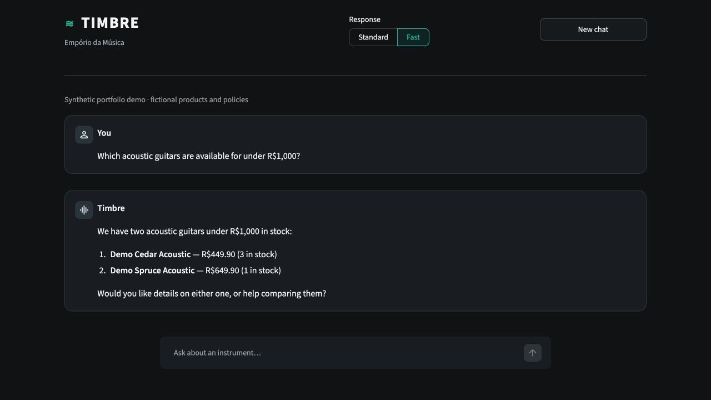
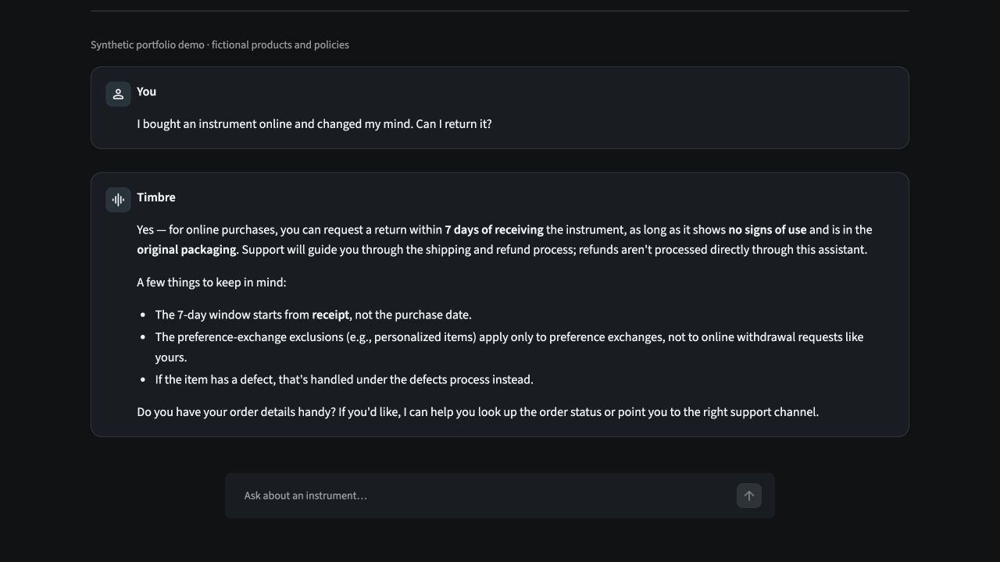
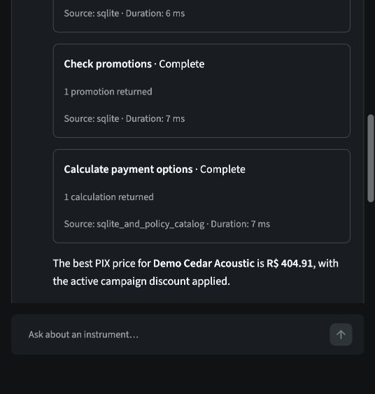
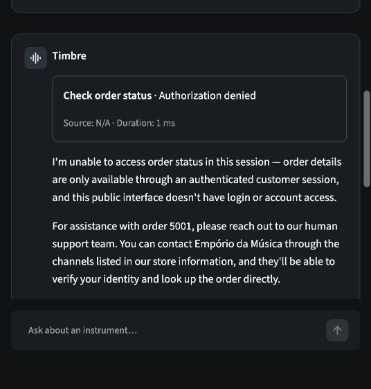
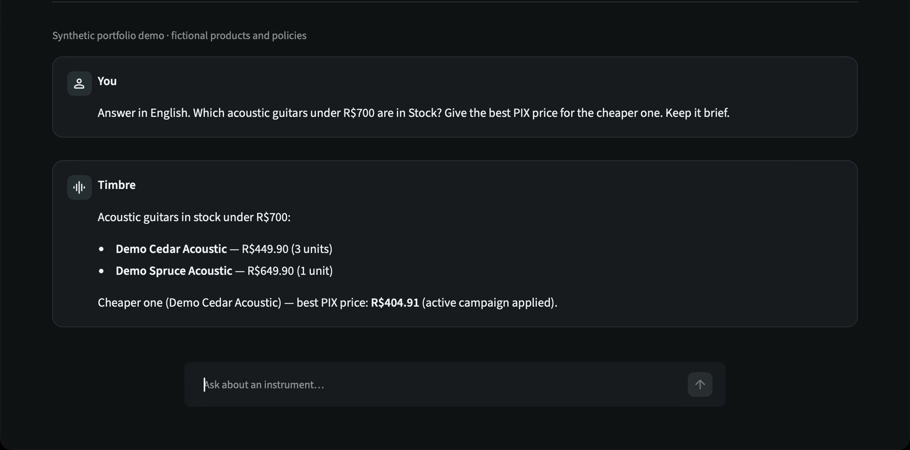
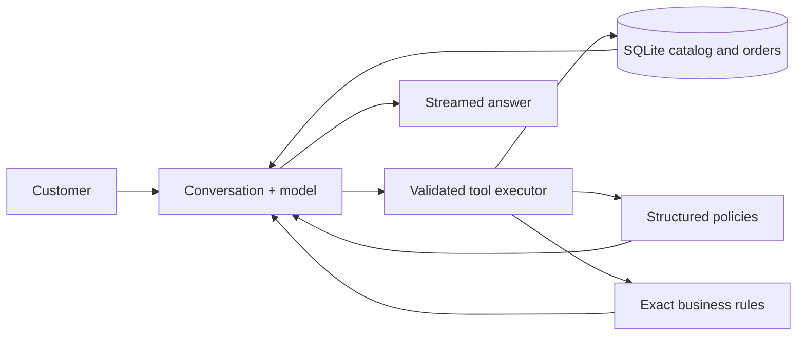
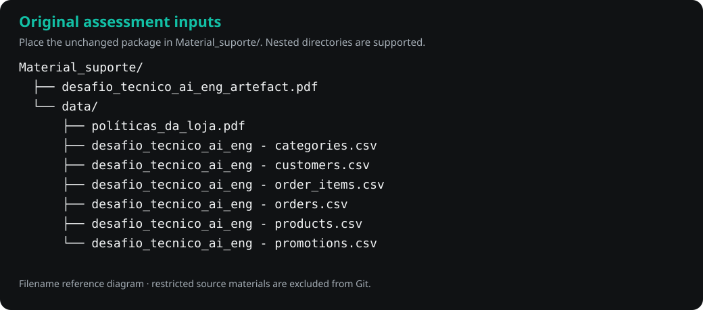

<div align="center">

# Timbre

**Find your next sound. Get an answer backed by the store's data.**

A conversational support assistant for discovering musical instruments, checking
prices and availability, understanding policies and comparing payment options.

Originally developed for Artefact's AI Engineer technical assessment, using the
fictional retailer **Empório da Música**.

[See it work](#see-it-work) · [How it works](#how-it-works) ·
[Evaluation](#evaluation) · [Quickstart](#quickstart) ·
[Original data](#using-the-original-assessment-data) · [Architecture](docs/architecture.md)

</div>



<sub>Actual Streamlit interaction · synthetic catalog · 3 November 2026. Prices and stock
come from real tool execution against the public fixture.</sub>

## The problem

An instrument shop's attendants repeatedly answer the same questions: which guitars
fit a budget, whether an item is available, what PIX or installments would cost,
where the shop is, and how returns work. These questions require different evidence.
A fluent answer is useful only when its facts and commercial conditions are correct.

Timbre lets the model choose a small set of business tools while Python owns data
access, monetary calculations and authorization. Both interfaces use the same engine.

## What it does

| Customer need | Implemented behavior |
|---|---|
| Find an instrument | Category, product, brand and price filters; only active, stocked items are purchasable |
| Compare products | Catalog prices and recorded specifications, with conversational follow-ups |
| Understand policies | Source-linked retrieval; separate online withdrawal, defects, exchange and warranty |
| Compare payment options | Exact PIX/campaign amounts and installment eligibility; discounts never stack |
| Ask about an order | Backend owner verification required; public sessions are denied |
| Inspect execution | Developer view shows actual tools, statuses, sources, durations and cost coverage |

The assistant is instructed to follow the customer's language, including English and Brazilian Portuguese.
Static interface labels and engineering documentation use English.

## See it work

The [representative conversations](examples/README.md) identify their dataset,
actual responses, tool execution and review limits. Public examples use fictional
records and policies; original assessment outputs remain private.

The application requires no original files for the public demonstration. Its tools
execute real queries and calculations; no chatbot answers are hardcoded. Without
an inference key, the public tool smoke test still exercises the backend.



<sub>Online withdrawal starts at receipt. The assistant provides guidance; it does not process a refund.</sub>

| Real commercial tools | Real privacy boundary |
|---|---|
|  |  |
| Promotions and exact payment calculations use the shared backend. | An unauthenticated session receives no private order row. |

[](docs/assets/timbre-demo.mp4)

**[Watch the live demonstration (MP4)](docs/assets/timbre-demo.mp4)** · 40 seconds ·
actual typed prompts, streamed answers, catalog/payment tools and a backend-denied
order lookup. Synthetic data, real inference; no canned answers.
[Recording details](docs/evaluation.md#demonstration-assets-and-live-video).

## How it works



The model cannot run arbitrary SQL or supply an authenticated customer identity.
Six read-only tools handle search, details, policies, promotions, payment calculations
and restricted order status. Completed turns preserve context; failed or interrupted
responses never enter committed model history. [Architecture and decisions](docs/architecture.md)
explain the implemented boundaries and tradeoffs.

## Evaluation

The [evaluation record](docs/evaluation.md) distinguishes offline contracts,
controlled integration tests, real OpenRouter calls and manual answer review.
Twenty scenarios cover the four original assessment examples, commercial rules,
language/context, privacy, backend failures and interrupted generation. Expected
facts come from SQLite and source policies, not the model's opinion of its answer.

The initial one-repetition comparison passed deterministic checks in **14/17 Standard**
and **16/17 Fast** scenario trials; both completed **18/19 turns**. Focused regressions
passed after fixes, while language/paraphrase variability remains documented. These
figures are execution/fact checks, not a universal answer-accuracy claim.

Offline timings are not model performance,
and a deterministic tool check is not an overall conversational quality score.

## Quickstart

Requirements: **Python 3.11+**, SQLite **3.38+** with JSON support, and access to
PyPI for installation. Run all commands from the repository root. Public data
preparation needs no PDF software or assessment files.

```bash
git clone https://github.com/henrikmm/timbre-ai-agent.git
cd timbre-ai-agent
python3 -m venv .venv
source .venv/bin/activate
python -m pip install '.[web]'
python scripts/prepare_demo.py
python scripts/validate_snapshot.py --database data/demo/store.db --policies local/demo/policies.json
python scripts/demo_tools.py
python -m unittest discover -s tests -v
```

The demo has **22 synthetic records** across the same six tables and **18 synthetic
policy sections**. Its products, prices, contacts and terms are invented. Four
original-material tests are skipped unless explicitly enabled. The smoke command
needs no key and does not simulate a conversation.

To chat, configure your own OpenRouter key privately:

```bash
cp -n .env.example .env
chmod 600 .env
# Edit OPENROUTER_API_KEY in .env with your local editor.
python -m timbre --config config/demo.toml
# Or launch the web interface:
TIMBRE_CONFIG=config/demo.toml streamlit run app.py
```

Open [Timbre locally](http://127.0.0.1:8501). Sending a message can incur inference
charges. An exported `OPENROUTER_API_KEY` takes precedence over `.env`. Never commit
or share your key. No inference key is distributed with this repository.

Try: `Recommend a beginner acoustic guitar under R$900 and explain its PIX and
installment options.` Then ask: `What about the second one?`

Developer view uses trusted server configuration:

```bash
TIMBRE_CONFIG=config/demo.toml TIMBRE_WEB_VIEW=developer streamlit run app.py --server.port 8502
```

Open [Developer view](http://127.0.0.1:8502). It has the same permissions as Customer
view. There is no in-page identity simulation or diagnostic privilege switch.

## Using the Original Assessment Data

An evaluator with the supplied Artefact package can reconstruct the original
snapshot. The package is not redistributed. Place its contents in the ignored
`Material_suporte/` directory **without renaming or editing the supplied files**.
The preparation script searches recursively, so the supplied `data/` subdirectory
is supported:

```text
Material_suporte/
├── desafio_tecnico_ai_eng_artefact.pdf
└── data/
    ├── políticas_da_loja.pdf
    ├── desafio_tecnico_ai_eng - categories.csv
    ├── desafio_tecnico_ai_eng - customers.csv
    ├── desafio_tecnico_ai_eng - order_items.csv
    ├── desafio_tecnico_ai_eng - orders.csv
    ├── desafio_tecnico_ai_eng - products.csv
    └── desafio_tecnico_ai_eng - promotions.csv
```



Install **Poppler** if `pdftotext -v` is unavailable: `brew install poppler` on
macOS, or `sudo apt-get install poppler-utils` on Debian/Ubuntu. Then, in the
fresh environment installed above:

```bash
python scripts/prepare_data.py --source-dir Material_suporte
python scripts/import_data.py --report local/import_report.json
python scripts/prepare_policies.py
python scripts/validate_snapshot.py --expect-supplied-snapshot --report local/validation_report.json
TIMBRE_RAW_DIR=data/raw TIMBRE_POLICIES_PATH=knowledge/policies.json python -m unittest discover -s tests -v
python -m timbre
# Or:
streamlit run app.py
```

The verified supplied snapshot has **191 records**: 9 categories, 65 products,
50 customers, 20 orders, 22 order items and 25 promotions. Policy preparation
reconstructs **29 sections from eight pages**. The original Portuguese policy
text and source bytes remain unchanged. Validation prints aggregate evidence,
not customer records. `--expect-supplied-snapshot` checks this particular package's
counts and is not a permanent application limit.

A clone without these restricted inputs cannot reproduce the original-store facts.
Use the public demonstration instead. Its data lives at separate paths; both
workflows use the same code, schema and tool contracts.

## Importing another compatible snapshot

For an authorized six-table CSV snapshot, the importer also accepts `categories.csv`,
`products.csv`, `customers.csv`, `orders.csv`, `order_items.csv` and `promotions.csv`.
Place exactly one canonical or assessment-named file per table in the input directory.
Missing files, ambiguous pairs, unexpected columns and invalid values are rejected.

| CSV | Required columns |
|---|---|
| categories | `category_id,name,description` |
| products | `product_id,price_brl,name,category_id,description,stock_quantity,status,specs,created_at` |
| customers | `customer_id,name,phone,email,city` |
| orders | `order_id,customer_id,order_date,status,total_brl,payment_method,tracking_code,estimated_delivery,notes` |
| order_items | `order_id,quantity,product_id` |
| promotions | `promotion_id,product_id,discount_percent,description,is_active` |

Use UTF-8 CSV, decimal-point BRL amounts with at most two decimals, ISO `YYYY-MM-DD`
dates, JSON objects in `specs`, and `0`/`1` promotion flags. Empty nullable fields
become SQL NULL. IDs and quantities must be positive; stock can be zero. Money
is stored as exact cents, discounts as basis points. Text values are preserved.

```bash
python scripts/import_data.py --raw-dir data/custom-raw --database data/custom.db --report local/custom-import.json
python scripts/validate_snapshot.py --database data/custom.db --policies local/custom-policies.json
```

A custom store must provide a reviewed catalog in the same structured policy format;
see the synthetic JSON for its schema. The PDF extractor supports the reviewed
assessment manual version 2.1, not arbitrary PDFs. Payment calculations fail safely
when a policy's required structure is missing. Copy the packaged TOML to a private
`local/custom.toml`, update `[tools]` paths, and pass it through `--config` or
`TIMBRE_CONFIG`. Keep original and synthetic inputs clearly identified.

## Configuration and operation

[Default settings](src/timbre/resources/default.toml) and [demo settings](config/demo.toml)
are complete non-secret TOML files; paths are relative to the current working
directory. They configure models, timeout/output budgets, streaming, history, routing,
data paths, tool limits and metrics. Custom files replace the complete configuration.

Current Standard uses DeepSeek; Fast uses Beam with latency-prioritized routing.
GPT-OSS was replaced during earlier validation; see [the decision](docs/architecture.md#models-and-inference).
Neither mode is a latency guarantee. CLI commands include `/mode standard`,
`/mode fast`, `/clear`, `/stats`, `/trace`, `/debug on`, `/debug off`, and `/exit`.
Mode switching preserves context; clearing a chat retains session metrics.

```bash
# Plan only: no inference, credentials or charges.
python scripts/evaluate.py --config config/demo.toml --dataset synthetic
# Real backend contracts, no model calls.
python scripts/evaluate.py --config config/demo.toml --dataset synthetic --offline
# Explicitly billable, bounded pilot; use the default config for original data.
python scripts/evaluate.py --dataset original --scenario E01 --scenario E04 --mode both --repetitions 1 --live
```

Each execution writes a unique private JSON/Markdown report under `local/evaluations/`.
Inspect the planned request bound before a larger run. Detailed transcripts stay
private; publish only reviewed synthetic examples or sanitized aggregate evidence.

## Limitations and next steps

Data is a static snapshot, with no ERP, carrier or checkout integration. All tools
are read-only. Public order access is denied because production authentication does
not exist. Commercial interpretations are documented demonstration decisions,
not approvals from a real retailer. Models and providers are external, variable and
potentially billable. Local files and logs require an operator's access/retention
controls. This is a loopback demonstration, not a public production service or an
LGPD compliance claim. Next steps are approved business rules, verified identity,
refreshed data and repeated task-level evaluations.

## AI-Assisted Development

I used AI coding assistance throughout this project as part of an iterative
engineering workflow. OpenAI Codex was my primary coding agent. I specified the
requirements, architectural direction, technology choices, tool interfaces, security
boundaries and expected behavior, then refined the implementation using observed
tests and model runs. AI assistance supported implementation, documentation and
validation; technical direction, evaluation criteria and final decisions remained
my responsibility. The evidence record distinguishes executed checks from pending
human review and does not imply that every implementation detail was manually checked.
