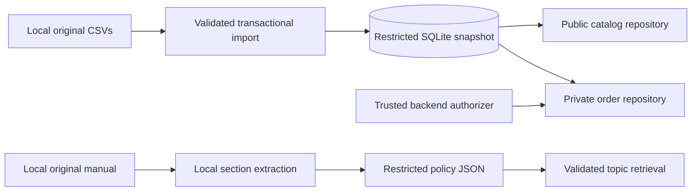

# Phase 1 architecture and security boundaries

SQLite provides relational integrity and exact integer storage. JSON provides
transparent policy records with source references. Runtime and tests use Python's
standard library; local Poppler is needed only for PDF preparation/verification.

## Responsibilities

| Component | Responsibility | Intended caller |
|---|---|---|
| `scripts/prepare_data.py` | Locate the full delivery and copy unchanged local bytes | Developer / evaluator |
| `database/import_data.py` | Validate and atomically rebuild six tables | Trusted maintenance code |
| `database/schema.py`, `values.py` | Constraints and exact numeric representations | Internal data layer |
| `database/connection.py` | Short-lived connections, read-only for queries | Internal data layer |
| `CatalogRepository` | Public catalog/category/promotion projections | Future public tool adapters |
| `OrderRepository` | Verify identity, enforce ownership, return minimal status | Future trusted private adapter |
| `authorization.py` | Provider protocol and deny-all default | Trusted backend composition |
| `knowledge/extraction.py` | Reviewed local extraction and provenance | Preparation script |
| `PolicyCatalog` | Validate JSON and retrieve complete topics | Future policy adapter |
| `scripts/validate_snapshot.py` | Aggregate evidence without personal data | Developer / evaluator |
| `tests/support.py` | Synthetic data and isolated session simulation | Tests only |

## Data flow

Only preparation/import writes data. Queries do not place orders, reserve products,
recalculate stock, or process money.

## Information classification

| Classification | Examples | Interface |
|---|---|---|
| Public business information | Catalog, prices, specifications, availability, eligible campaigns | `CatalogRepository` |
| Knowledge for service | Hours, commercial terms, service guidance | Local `PolicyCatalog`; future adapter presents relevant customer-facing information |
| Restricted identities | Customer names, phones, emails, cities | No conversational customer-list interface |
| Restricted operations | Individual orders, tracking, free-text notes | Owner-checked status/history projections only |
| Restricted artifacts | Full delivery, internal manual, derived JSON, database, detailed notes | Ignored local files |

Some manual information may be suitable for a customer answer while the complete
document remains internal. Answering a policy question does not authorize full
republication of its source.

## Authorization contract

Trusted backend code injects an authorizer when constructing `OrderRepository`.
The default `DenyAllAuthorizer` rejects every private request **before** opening
the database. The requested order ID and opaque session context are separate.

A future `require_customer_id(context)` provider must verify an application-issued
session before returning an integer identity. It must not trust a name, phone,
order number, dictionary field, or model-supplied customer identifier. No production
session issuer, login, OAuth, OTP, or environment bypass exists in Phase 1.

After verification, the query filters by **both** order ID and verified customer ID.
Nonexistent and other-customer orders produce the same `OrderNotFound` response.
`get_my_orders()` also filters by the verified owner with bounded pagination.
Neither method accepts a customer override.

Private results contain only `order_id`, `order_date`, `status`, `tracking_code`,
and `estimated_delivery`. They do not join customer records or include names,
phones, email, city, notes, payment details, or customer IDs.

The test-only issuer binds opaque object identities to synthetic customer IDs in
an isolated registry. Fabricated objects and claimed fields fail. Tests explicitly
inject that issuer; it is not imported by production code or public examples.

## Evidence limits

Tests establish ownership and projection behavior under a trusted-backend threat
model. They do not establish real authentication, network security, isolation, or
protection against a malicious trusted provider. Anyone able to execute arbitrary
backend Python, inject an authorizer at startup, or open the SQLite file can bypass
these interfaces. The database itself does not enforce customer ownership.

Read-only connections prevent accidental writes; they do not provide row-level
confidentiality. File protection, trusted backend composition, allowlisted tools,
and real identity verification are application responsibilities.

## Future tool integration

The eventual public allowlist can wrap product/category searches, details,
eligible promotions, and topic retrieval. No OpenRouter tool schemas exist yet.
Private adapters must bind a verified session outside model arguments; the model
cannot choose an authorizer, create a session, or select an owner. Backend errors
should become appropriate pt-BR responses without traces or existence leaks.

The LLM will interpret intent, choose tools, and phrase answers. Python will enforce
authorization and commercial calculations. Resolve ambiguous terms before enabling
their calculations. Keep one reviewed, source-linked numeric rule configuration
rather than divergent rules in prompts, tools, and documents.

## Language and evaluation

Engineering identifiers, comments, docstrings, configuration keys, tests, notes,
commits, technical reports, and submission explanations use English. Original
filenames, CSV values, and extracted policy headings/bodies retain Portuguese;
English metadata surrounds the source content.

The future persona will use natural pt-BR according to the manual. Scenario titles,
expected behavior, technical annotations, and needed translations will be English.
Current examples exercise repositories; actual agent conversations will be captured
after the conversational implementation exists.

## Deliberate exclusions

No LangChain/LangGraph, embeddings, vector store, API server, UI, channel integration,
conversation history, authentication system, commercial transaction processing, or
administrative system is added. Dependencies can be reconsidered when an actual
integration requirement arises.
