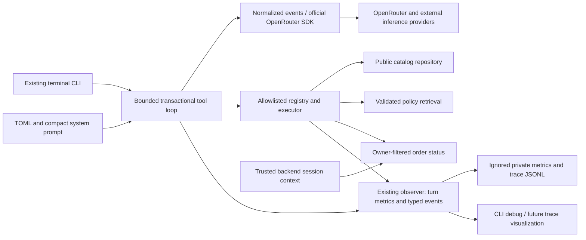
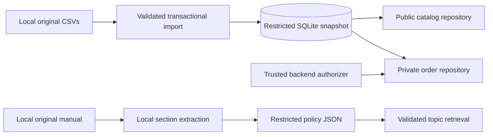

# Architecture and security boundaries

SQLite provides relational integrity and exact integer storage. JSON provides
transparent policy records with source references. The Phase 1 runtime and tests
use Python's standard library; local Poppler is needed only for PDF preparation/
verification. Phase 2 adds the official OpenRouter SDK and a dotenv reader, with
no agent framework. The operational data layer remains separate from the LLM.

## Phase 3A conversational flow

`config.py` validates the provider settings plus `[tools]` paths and execution
budgets. `llm/openrouter.py` isolates SDK serialization, routing, stream/tool-delta
normalization, safe errors, and optional bounded generation metadata.
`conversation.py` owns session state, complete call reconstruction, matching
assistant/tool messages, iteration limits, and final answer streaming. The executor
validates names and arguments and dispatches only controlled Python implementations.

Each interaction builds pending context from complete earlier turns. Tool requests
must finish normally with a tool-call finish reason before execution. Tool results
carry the matching protocol ID, including when the model requests multiple calls.
A successful final response commits the entire user/tool/assistant exchange. Errors,
truncation, incomplete tool streams, and interruption leave previous history intact.
Trimming removes complete oldest turns rather than orphaning tool messages. Mode
switching preserves context, reset preserves system instructions, and conversation
instances do not share session state. Concurrent use of one conversation object
is unsupported.

The compact prompt contains tool-use and security instructions rather than a copy
of the database or manual. Retrieved content is data, never an instruction that
can change authorization or system priority. The model interprets customer intent
and phrases answers; Python enforces data access, money rules, and private ownership.

`observability.py` extends the Phase 2 observer with typed events and aggregate
turn measurements. `cli.py` reads those same events for `/trace` and optional debug
output. Neither tracing nor debugging changes tool permissions. SDK objects and
hidden reasoning are not exposed through the presentation callback or telemetry.

See [ADR-006](decisions/006-function-calling-architecture.md),
[ADR-007](decisions/007-tool-design-business-rules.md),
[ADR-008](decisions/008-execution-tracing.md), and the
[Phase 3A operation and validation record](phase3a.md).

## Responsibilities

| Component | Responsibility | Intended caller |
|---|---|---|
| `scripts/prepare_data.py` | Locate the full delivery and copy unchanged local bytes | Developer / evaluator |
| `database/import_data.py` | Validate and atomically rebuild six tables | Trusted maintenance code |
| `database/schema.py`, `values.py` | Constraints and exact numeric representations | Internal data layer |
| `database/connection.py` | Short-lived connections, read-only for queries | Internal data layer |
| `CatalogRepository` | Public catalog/category/promotion projections | Public business tools |
| `OrderRepository` | Verify identity, enforce ownership, return minimal status | Restricted order tool |
| `authorization.py` | Provider protocol and deny-all default | Trusted backend composition |
| `knowledge/extraction.py` | Reviewed local extraction and provenance | Preparation script |
| `PolicyCatalog` | Validate JSON and retrieve complete topics | Policy tool |
| `scripts/validate_snapshot.py` | Aggregate evidence without personal data | Developer / evaluator |
| `tests/support.py` | Synthetic data and isolated session simulation | Tests only |

## Data flow

Only preparation/import writes data. Queries do not place orders, reserve products,
recalculate stock, or process money.

## Information classification

| Classification | Examples | Interface |
|---|---|---|
| Public business information | Catalog, prices, specifications, availability, eligible campaigns | `CatalogRepository` |
| Knowledge for service | Hours, commercial terms, service guidance | Local `PolicyCatalog`; allowlisted tool retrieves relevant sections |
| Restricted identities | Customer names, phones, emails, cities | No conversational customer-list interface |
| Restricted operations | Individual orders, tracking, free-text notes | Owner-checked status/history projections only |
| Restricted artifacts | Full delivery, internal manual, derived JSON, database, detailed notes | Ignored local files |

Some manual information may be suitable for a customer answer while the complete
document remains internal. Answering a policy question does not authorize full
republication of its source.

## Authorization contract

Trusted backend code injects an authorizer when constructing `OrderRepository`.
The default `DenyAllAuthorizer` rejects every private request **before** opening
the database. The requested order ID and opaque session context are separate.

A future `require_customer_id(context)` provider must verify an application-issued
session before returning an integer identity. It must not trust a name, phone,
order number, dictionary field, or model-supplied customer identifier. No production
session issuer, login, OAuth, OTP, or environment bypass exists in Phase 3A.

After verification, the query filters by **both** order ID and verified customer ID.
Nonexistent and other-customer orders produce the same `OrderNotFound` response.
`get_my_orders()` also filters by the verified owner with bounded pagination.
Neither method accepts a customer override.

Private results contain only `order_id`, `order_date`, `status`, `tracking_code`,
and `estimated_delivery`. They do not join customer records or include names,
phones, email, city, notes, payment details, or customer IDs.

The test-only issuer binds opaque object identities to synthetic customer IDs in
an isolated registry. Fabricated objects and claimed fields fail. Tests explicitly
inject that issuer; it is not imported by production code or public examples.

## Evidence limits

Tests establish ownership and projection behavior under a trusted-backend threat
model. They do not establish real authentication, network security, isolation, or
protection against a malicious trusted provider. Anyone able to execute arbitrary
backend Python, inject an authorizer at startup, or open the SQLite file can bypass
these interfaces. The database itself does not enforce customer ownership.

Read-only connections prevent accidental writes; they do not provide row-level
confidentiality. File protection, trusted backend composition, allowlisted tools,
and real identity verification are application responsibilities.

## Tool integration and financial rules

The registry exposes product search/details, flagged snapshot promotions, relevant
policy topics, deterministic payment options, and private order status. It does
not expose generic tables, SQL, customer listing, filesystem access, code execution,
or mutations. The order schema accepts an order ID; identity is bound separately
by trusted backend code. Unknown tools, invalid arguments, no results, backend
failure, and authorization denial produce distinct structured outcomes.

Sale availability requires exact `active` status and positive stock. Category
aliases bridge English requests to source-language values. Brand matching uses
product-name evidence because the source schema lacks a dedicated brand column.
Structured specifications remain source values rather than inferred repairs.

Financial calculations derive product prices from SQLite and reviewed rules from
the local policy catalog. Decimal values serialize as strings; discount stacking
is prevented. The detailed installment schedule, lowest non-stacked PIX option,
active-offer flags, contact alternatives, and inclusive local freight threshold are
adopted demonstration decisions. A source-derived resolved projection accompanies
raw policy evidence without changing it; see ADR-010. Original source limitations
remain in engineering material rather than repetitive customer disclaimers. Calculators do not authorize payment, a
reservation, a policy exception, or a transaction. Historical order tracking is
snapshot information, not a live carrier query.

## Language and evaluation

Engineering identifiers, comments, docstrings, configuration keys, tests, notes,
commits, technical reports, and submission explanations use English. Original
filenames, CSV values, and extracted policy headings/bodies retain Portuguese;
English metadata surrounds the source content.

Phase 3B keeps all static CLI/web labels in English and uses the shared system
prompt to follow the customer's language or explicit preference. Portuguese source
policy text and CSV values remain unchanged. Scenario titles, expected behavior,
technical annotations, and translations use English. Synthetic tests and bounded
live smoke findings are labeled separately; neither constitutes the Phase 4
formal evaluation suite.

## Deliberate exclusions

No LangChain/LangGraph, embeddings, vector store, separate API server, channel
integration, production authentication system, commercial transaction processing,
or administrative system is added. Conversation history remains in memory only.
Phase 3B's local Streamlit UI calls the existing conversation engine directly.
Its per-session display records never supply model history; only the backend owns
committed tool-call groups. Views do not change authorization. See
[ADR-009](decisions/009-streamlit-presentation.md). Phase 4 systematic evaluation
remains future work.
