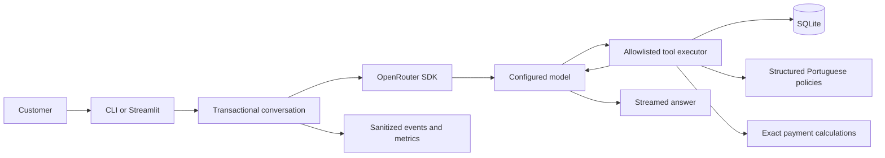

# Architecture and engineering decisions

Timbre is a local conversational support application for a fictional instrument
retailer. The CLI and Streamlit interface share one synchronous conversation engine,
one tool registry, one SQLite schema and one policy format. The original version was
developed for Artefact's AI Engineer technical assessment.

## Request lifecycle

The model proposes calls; Python validates and executes them. It cannot submit SQL,
choose a filesystem path, run code, authenticate a customer, or mutate business data.
A turn has at most four tool iterations, five model calls and twelve tool calls by
default. A 45-second turn deadline bounds generation and follow-up requests; metadata
lookups have their own two-second timeout per generation. There are no automatic
application retries. Provider failover and cross-model fallback are separate settings.

The engine assembles indexed streaming tool deltas, requires a complete terminal
`tool_calls` response, validates the entire call and associates each result with its
call ID. A nonempty final `stop` response commits the whole turn. A truncated,
interrupted, empty or failed attempt preserves the previous history. At most twelve
complete turns are retained in process memory; no conversation persistence is implied.
Reasoning may need to travel in the provider protocol but is never shown or logged.

## One schema, two loading workflows

| Workflow | Inputs | Generated destinations | Configuration |
|---|---|---|---|
| Public portfolio | Explicitly synthetic CSVs and hand-authored policy JSON in `tests/fixtures/demo/` | `data/demo/store.db`, `local/demo/policies.json` | `config/demo.toml` |
| Original assessment | Six original CSVs, policy PDF and assessment PDF in ignored `Material_suporte/` | `data/raw/`, `data/store.db`, `knowledge/policies.json` | Packaged default TOML |

`prepare_demo.py` calls the same `import_csvs` used by `import_data.py`; it does not
simulate a model or return canned answers. The small public fixture retains the
existing test IDs and schemas, with coherent fictional product names, two available
acoustic instruments, unavailable/status edge cases and active/inactive promotions.
Its monetary terms and contacts are invented, distinct from the supplied business
materials. The web page labels this dataset explicitly. Switching configuration
changes input paths and telemetry destinations, not the application's business logic.
Do not combine a database from one dataset with policies from the other.

`prepare_data.py` recursively locates the complete original filename set, including
Unicode-normalized accent matching. Missing or duplicate files fail before copying.
It copies unchanged bytes into the ignored raw directory, preflights source/destination
overlap and never edits the package. The assessment PDF is retained as a local source;
it is not used as the store policy. SHA-256 import reports identify exact source CSV
bytes. Policy provenance separately identifies the PDF bytes.

The importer accepts either `<table>.csv` or `desafio_tecnico_ai_eng - <table>.csv`
for each table, and rejects ambiguous pairs. Headers must have exactly the required
column names; order may vary. UTF-8/BOM, quoted commas, JSON objects, ISO dates,
nullable empty fields, integer bounds, unique/composite keys and foreign keys are
validated. Replacement is atomic and idempotent. Failed imports retain the previous
snapshot and refuse unrelated databases. Error messages identify table/field/record
locations without echoing personal values.

SQLite stores money as integer cents and discounts as basis points. Conversion is
exact, never binary float rounding. Text, JSON strings and historical totals retain
the source values. Original files/columns remain unchanged; only the destination
representation changes.

| Table | Key and relationships |
|---|---|
| `categories` | `category_id` primary key |
| `products` | `product_id`; category FK; price/stock/status/specifications |
| `customers` | `customer_id`; private contact fields |
| `orders` | `order_id`; customer FK; historical total/status/delivery |
| `order_items` | Composite `(order_id, product_id)`; order/product FKs |
| `promotions` | `promotion_id`; product FK; discount and active flag |

Read connections use SQLite read-only mode. Public catalog queries are parameterized,
escape LIKE wildcards and return bounded results. English category aliases map to
Portuguese category names without changing stored values. Brand matching uses name
tokens because no independent brand column exists. Availability requires both
`active` status and positive stock. Historical order totals are not recomputed from
today's catalog prices.

## Policy retrieval and service decisions

The original version 2.1 manual is extracted with Poppler, not sent wholesale in the
prompt. Twenty-nine sections retain Portuguese content, page spans, document hash,
version, hierarchy and related topics. The loader validates the complete catalog,
rejects cycles/invalid provenance and returns copies. Retrieval matches a topic and
its descendants, retains parent introductions and optionally includes related clauses.
A new manual version requires review of the section map and rule parsing. Synthetic
policies satisfy the same structural contract without needing Poppler or an invented PDF.

A structured catalog is sufficient for this small, known document. Embeddings, a
vector database or an agent framework would add operational and evaluation costs
without improving this version's explicit topic interface.

Source discrepancies are resolved in a separate service projection; originals are
never repaired silently. These are project demonstration decisions, requiring actual
business approval before production:

| Issue | Adopted behavior |
|---|---|
| Different contact spellings/numbers | Return all requested alternatives, deduplicated and unchanged; no assertion of deliverability |
| Summary versus detailed installment minimums | Detailed tiers take precedence; check the smallest cent-allocated installment |
| Local free-shipping equality gap | Include equality at the source-derived free-shipping threshold |
| Preference exchange start event | Count from receipt |
| Broad exchange exclusions | Apply to discretionary preference exchanges; online withdrawal/defects retain their own clauses |
| Campaigns without validity/audience fields | Active flags define this snapshot's demonstration offers; infer no expiry |
| Competing PIX/campaign discounts | Choose the lowest single eligible offer, stable ID tie-break; never compound discounts |
| Conflicting product prose | Name determines identity; structured specifications determine technical attributes |
| Historical totals differ from current prices | Preserve recorded totals and report the aggregate discrepancy without inventing a cause |
| Mixed payment or unsupported actions | Explain sourced conditions and supported next steps; no charge, reservation, refund or transfer is performed |

## Tool boundary

| Tool | Responsibility |
|---|---|
| `search_products` | Catalog filters and available-product recommendations |
| `get_product_details` | Verified price, stock, status and specifications by ID |
| `get_store_policy` | Source-linked sections and resolved service terms |
| `get_active_promotions` | Active offers on sellable products, independently calculated |
| `calculate_payment_options` | Decimal PIX, campaign and installment calculations from a trusted product ID |
| `get_my_order_status` | Minimal historical order projection for a backend-verified owner |

The allowlist rejects unknown tools/fields, duplicate JSON keys, malformed arguments,
null optional values, boolean IDs and invalid ranges. Outcomes distinguish success,
empty, invalid arguments, authorization denial and backend failure. Tool text and
customer input are untrusted data; they never change the allowlist or privileges.
Payment calculations derive their terms from the policy catalog and fail closed
when its reviewed structure cannot be parsed. Installment cents sum exactly to the
quoted price. A calculation is not checkout or a confirmed live commercial quote.

## Models and inference

| Mode | Current model | Routing |
|---|---|---|
| Standard | `deepseek/deepseek-v4.1-flash-1017` | Default provider balance |
| Fast | `reflection/beam-1.0-501b-a23b` | Latency priority |

Standard is the cost-conscious default for general support and multi-step tool use.
Fast offers a lower-latency option; it was quicker but slightly more expensive in
the initial controlled sample. The comparison informs this configuration without
establishing a universal model ranking.

Both use the pinned official OpenRouter SDK, tool schemas, streaming and a default
2,048-token output budget per model call. The budget includes reasoning and generated
tool-call arguments; a previous 512-token setting caused truncation. Optional sampling/reasoning
controls are omitted unless verified for the configured model and route.

GPT-OSS was an earlier Fast model. The implemented configuration replaced it after
observed language, certainty and latency problems. This consolidation preserves that
accepted choice rather than silently reverting it to match an older brief. The
formal comparison uses the current modes and reports actual models/providers.
It does not establish a new GPT-OSS comparison or a universal model ranking.

[OpenRouter's model catalog](https://openrouter.ai/models) describes the hosted
models. Open weights can enable alternative hosting, but this implementation calls
external inference providers and is not local inference. Weight availability does
not remove model-license, hosting, privacy, infrastructure or service-availability
requirements. Routing requires tool-parameter support and requests
`data_collection=deny`; this preference is not a legal compliance guarantee.
[Provider routing](https://openrouter.ai/docs/guides/routing/provider-selection)
can change availability, latency and price. All model claims are bounded by the
observed runs in [evaluation](evaluation.md).

## Authorization and privacy

Public CLI and web sessions use `DenyAllAuthorizer`. Names, phones, emails, IDs,
Developer view and claimed identity never authenticate anyone. Authorization runs
before opening private data. A trusted backend may inject an opaque verified context;
owner reads filter by both order and verified customer ID. Other-owner and nonexistent
orders have the same unavailable outcome. No customer-directory tool exists.
Test-only identity issuance stays exclusively in `tests/support.py` and integration
tests. There is no impersonation control in either interface.

Original CSV/PDF files, extracted policies, databases, detailed reports, logs and keys
are ignored and owner-only where generated. Public text examples use synthetic
inputs; the owner-selected main video shows the original store's public catalog and
policy answers, with no private customer records.
External inference sees bounded customer context and relevant tool results; production
would still require lawful-purpose review, processor contracts, international-transfer
review, retention/deletion controls, real authentication and abuse protection. This
prototype does not claim LGPD certification. Local file possession is a trusted
operator boundary, not an application permission system.

## Presentation and observability

Streamlit owns only display records and one session-scoped `Conversation`. Queued
input is consumed before execution, preventing rerender resubmission. Model switching
preserves context; **New chat** clears visible/backend history and retains session
metrics. Failed partial text is labeled incomplete; retry requires a separate explicit
submission. BRL markers are escaped for Markdown display only.

`TIMBRE_WEB_VIEW=developer` is selected by the server at startup, never by URL or
customer input. Its progressive activity panel and detailed timeline use the same
sanitized `TraceEvent` objects as the CLI `/trace`. It has no additional business
authority. Both presentations bind to loopback and have no production login.

One existing `Observer` records a schema-version-2 metrics row per interaction and
correlated request/tool events in a sibling traces JSONL. No second telemetry system
is added by evaluation. Logs contain safe tool names, redacted free-text/private IDs,
logical sources, counts, statuses, timings and anonymous correlations; no prompts,
answers, rows, raw errors, keys or hidden reasoning. Evaluation explicitly saves
separate private transcripts to enable manual review; these are never public logs.

Metrics aggregate usage once per model call. `overall_latency_seconds` includes
metadata lookup; `total_latency_seconds` measures answer availability. Tool durations
and nested spans overlap and must not be added to customer wait time. Missing token,
cost or provider fields remain unavailable, with coverage counts and observed cost
subtotals. Metadata lookups occur at most once per generation, without retries.
In-memory traces are bounded to 2,000 events. Persistent log rotation/retention is
still a production requirement.

## Boundaries and next steps

The snapshot is static; no ERP, carrier, checkout or production identity integration
exists. Synchronous per-session execution favors a reviewable local prototype over
concurrent serving. Language and helpfulness remain probabilistic, and policy parsing
is version-specific. Production work would prioritize approved business rules, real
authentication, refreshed source data, deployment controls and repeated task-level
monitoring before adding more tools or infrastructure.
