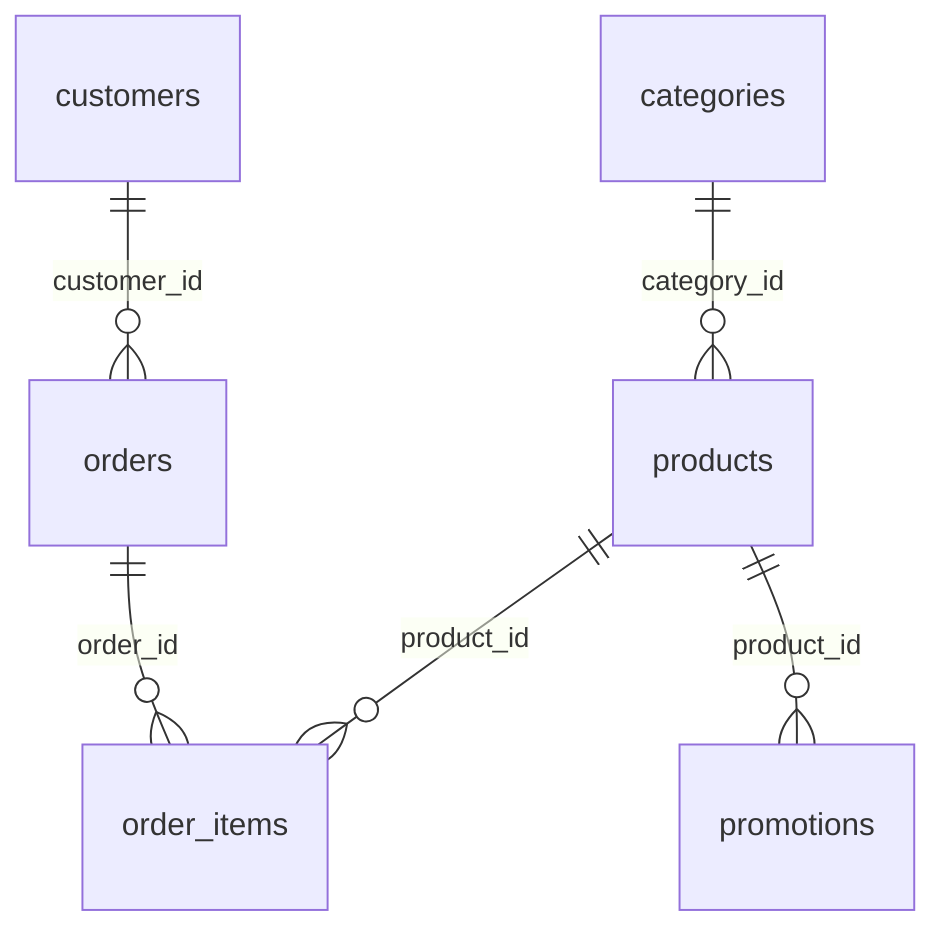

# Data model

The six CSVs describe a fictional snapshot. Imports preserve the source records
without repairing commercial inconsistencies. No operational IDs are invented.

## Relationships

Every connection enables `PRAGMA foreign_keys=ON`. No supplied reference is orphaned.
The pair `(order_id, product_id)` is unique across all 22 original item rows and
forms their primary key. Future duplicate pairs fail import and require a reviewed
schema change; rows are not merged.

## Tables

`?` means nullable; other columns are required. The authoritative executable DDL
is `src/timbre/database/schema.py`.

| Table | SQLite columns | Primary key |
|---|---|---|
| `categories` | `category_id INTEGER`, `name TEXT`, `description TEXT?` | `category_id` |
| `products` | `product_id INTEGER`, `price_cents INTEGER`, `name TEXT`, `category_id INTEGER FK`, `description TEXT?`, `stock_quantity INTEGER`, `status TEXT`, `specs TEXT?`, `created_at TEXT` | `product_id` |
| `customers` | `customer_id INTEGER`, `name TEXT`, `phone TEXT?`, `email TEXT?`, `city TEXT?` | `customer_id` |
| `orders` | `order_id INTEGER`, `customer_id INTEGER FK`, `order_date TEXT`, `status TEXT`, `total_cents INTEGER`, `payment_method TEXT?`, `tracking_code TEXT?`, `estimated_delivery TEXT?`, `notes TEXT?` | `order_id` |
| `order_items` | `order_id INTEGER FK`, `quantity INTEGER`, `product_id INTEGER FK` | `(order_id, product_id)` |
| `promotions` | `promotion_id INTEGER`, `product_id INTEGER FK`, `discount_basis_points INTEGER`, `description TEXT?`, `is_active INTEGER` | `promotion_id` |

Four indexes support product-category, order-customer, item-product, and
campaign-product lookups. `PRAGMA user_version=1` records the schema version.

## Exact numeric types

| Source CSV column | SQLite column | Exact conversion | Read type |
|---|---|---|---|
| `products.price_brl` | `price_cents` | `Decimal(source) * 100` | `Decimal` BRL |
| `orders.total_brl` | `total_cents` | `Decimal(source) * 100` | Omitted from status projection |
| `promotions.discount_percent` | `discount_basis_points` | Percentage points × 100 | `Decimal` percent |

For a synthetic example, BRL `449.9` becomes `44990` cents and is read as
`Decimal("449.90")`; a `12.50` percent discount becomes `1250` basis points.
Conversion never rounds: non-finite, negative, overflowing, or sub-cent/basis-point
values are rejected. Extra trailing zeros are allowed when equivalence is exact.
Binary floats and booleans are rejected as money input. Raw CSV spelling stays
unchanged; the database preserves numerical equivalence.

Stock is non-negative. Item quantity and IDs are positive integers within SQLite's
signed 64-bit range. The boolean source must be `0` or `1`, constrained in SQLite.
Discounts are between 0 and 100 percent.

## Dates, text, JSON, and nulls

- Dates are validated calendar dates in exact `YYYY-MM-DD` format, stored as ISO
  text. No timezone or timestamp is invented.
- Empty optional fields map to SQL `NULL`. Required blanks fail. Optional
  whitespace and literal text such as `NULL` are not silently treated as missing.
- Telephone numbers, tracking codes, emails, payment methods, and statuses remain
  source text. No repair, lowercasing, or translation occurs.
- Product `specs` must be a JSON object or an empty optional field. Its original
  JSON string is stored unchanged and parsed into a dictionary for detail reads.
  Importer and SQLite JSON checks reject malformed JSON and non-objects.
- New non-empty status strings are preserved rather than limited to a closed
  enumeration. They remain unavailable unless exactly `active` with positive stock.

The supplied orders have 12 null tracking codes, 12 null delivery estimates, and 16
null notes. Other original fields are non-empty. Fixtures also exercise nullable
fields that happen not to be empty in the original snapshot.

## Import guarantees

The importer reads and validates all six UTF-8 CSVs before opening a write
transaction. It checks header membership/duplicates, record shapes, types, dates,
JSON, and ranges. Header order may vary; mapping uses original names. It reads
each table's bytes once and fingerprints the exact imported bytes.

Within `BEGIN IMMEDIATE`, it drops tables in reverse dependency order, recreates
them, and inserts in dependency order. Primary/foreign keys, `foreign_key_check`,
and `integrity_check` must pass before commit. Late failure rolls back DDL and data
together; a failed first load removes its newly created empty database.

Repeated valid imports yield the same records, values, and source hashes.
Identical SQLite file bytes across versions are not promised. This is complete
snapshot maintenance, not ERP synchronization or a migration framework. Unrelated
tables and unsupported schema versions are refused. Use a dedicated database.

## Business meaning and limits

Registered stock is never recalculated from historical orders. Positive stock
does not override discontinued/upcoming status. Historical references to currently
unavailable products remain intact.

`order_items` contains **only** `order_id`, `quantity`, and `product_id`. No historical
unit price, freight, tax, or applied discount exists. Stored order totals remain
unchanged. A comparison with today's catalog is only a diagnostic; it cannot
establish historical pricing errors.

Promotions have no dates, audience field, or stacking priority. Public offer reads
require the stored flag and sellability; they do not infer expiry from the month
or campaign name or choose among competing discounts.

Customer/order tables and generated databases are restricted. Ownership enforcement
and field classifications are described in `docs/architecture.md`.
